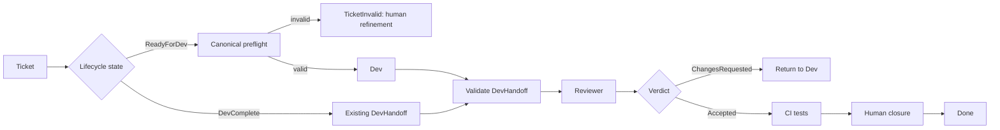

# AgentOps Conductor demo

This repository demonstrates one controlled Dev → Reviewer workflow through
three ticket states. The workflow definition is always the same:
`workflows/demo/agentops-demo.yaml`.



The scenarios are fixtures, not separate workflows.

| Scenario | Input ticket state | Route demonstrated |
| --- | --- | --- |
| Invalid ticket | `ReadyForDev`, missing `authorizationReason` | Preflight → `TicketInvalid`; no LLM is invoked. |
| Changes requested | `DevComplete` with a seeded, incomplete delivery | DevHandoff → Reviewer → `ChangesRequested`. |
| Happy path | Valid `ReadyForDev` ticket | Dev → DevHandoff → Reviewer → CI → human closure → `Done`. |

The second fixture is intentionally resumed at `DevComplete`: it demonstrates
that the same state machine can continue a real delivery after Dev has produced
evidence. Its faulty greeting implementation is explicit and exists only to
make the Reviewer route reproducible.

## Validate once

```powershell
conductor validate workflows/demo/agentops-demo.yaml
```

## Run each scenario

```powershell
# 1. Invalid ticket: finishes before any LLM invocation.
conductor run workflows/demo/agentops-demo.yaml --input ticket_dir=".agentops/tickets/ready-for-dev/TASK-20261006-001-ticket-invalid" --web

# 2. Existing Dev delivery: Reviewer requests changes.
conductor run workflows/demo/agentops-demo.yaml --input ticket_dir=".agentops/tickets/in-progress/TASK-20261006-002-reviewer-changes" --web

# 3. Full canonical-style route: approximately six minutes with live agents.
conductor run workflows/demo/agentops-demo.yaml --input ticket_dir=".agentops/tickets/ready-for-dev/TASK-20261006-003-happy-path" --web
```

## Reset after a run

```powershell
.\scripts\reset-demo.ps1
```

The reset returns the repository to the `demo-ready` tag and removes known
runtime artifacts. Run it before replaying a scenario or use a disposable Git
worktree.
